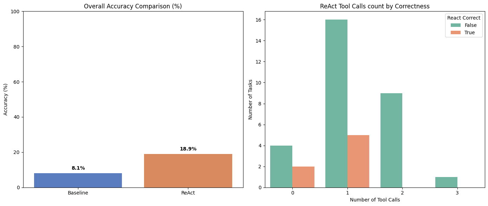

# Experiment Results: Baseline vs ReAct

## Overview
This report summarizes the evaluation of the language model (`Qwen/Qwen2.5-3B-Instruct`) on a subset of the MATH-500 dataset (Number Theory). The experiment compares two approaches:
1. **Baseline**: Direct reasoning without tool access.
2. **ReAct**: Interleaved reasoning and acting, with access to a `calculator` and a `python` executor.

## Results
- **Total Tasks**: 37
- **Baseline Accuracy**: 8.11%
- **ReAct Accuracy**: 18.92%

## Conclusion
The ReAct approach significantly outperformed the baseline, improving accuracy from 8.11% to 18.92%. This demonstrates the effectiveness of allowing the model to offload complex logic and computational tasks to external tools, reducing hallucination and calculation errors.
